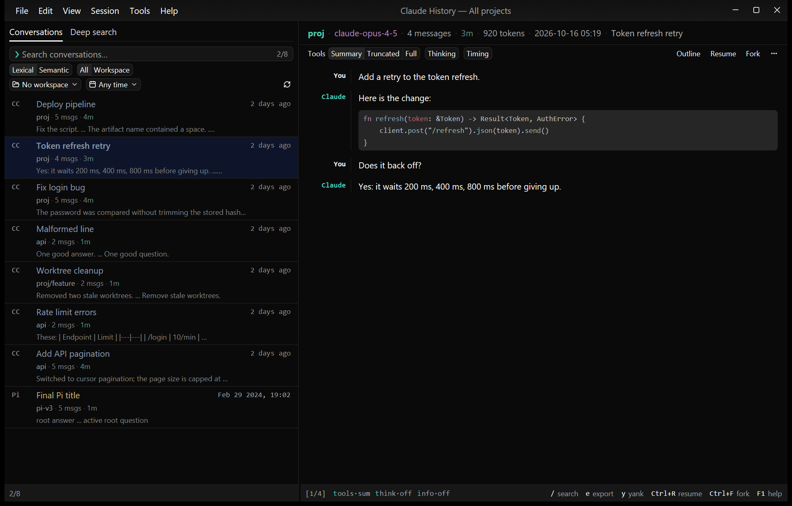
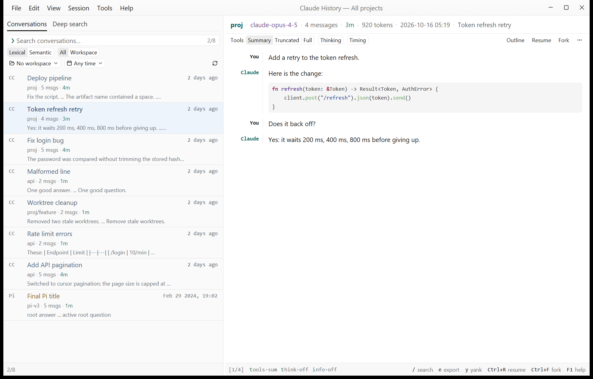
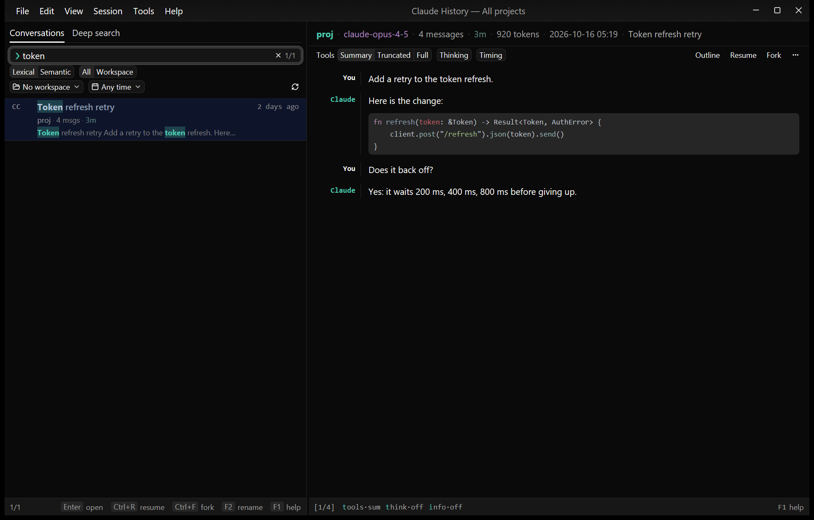
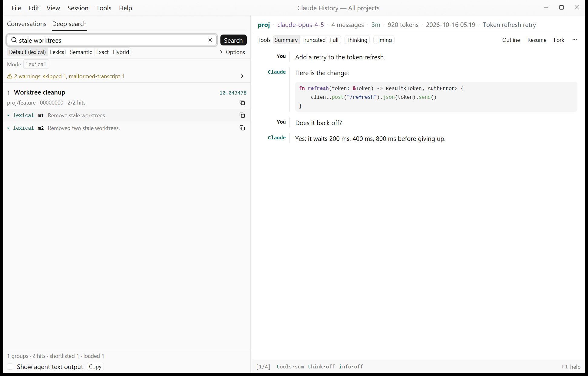

# claude-history-gui

A cross-platform desktop app (Windows, macOS, Linux) for browsing, searching and resuming your
**Claude Code, Pi and OMP conversation history**. It is a GUI port of the terminal app
[claude-history](https://github.com/raine/claude-history) and aims to cover every feature of the original,
built on [gpui-kit](https://crates.io/crates/gpui-kit) (GPUI) and a UI-agnostic core (`crates/core`).



## Credits and license

* The original **claude-history** is by [Raine](https://github.com/raine/claude-history), MIT licensed.
  `crates/core` is derived from it (v0.1.76); its license text is in
  [`crates/core/LICENSE-MIT`](crates/core/LICENSE-MIT) and that crate is distributed under the same MIT terms.
* The rest of the repository (the GUI crate, tools, docs) is under the repository [`LICENSE`](LICENSE)
  (the Unlicense).

## Screenshots

All screenshots show a synthetic fixture corpus (`crates/gui/tests/fixtures/qa-home`), not real conversations.

| | |
|---|---|
|  |  |
| Conversation viewer, light theme | List search with highlighted matches |
|  | |
| Deep search (agent protocol) with evidence cards | |

## Features

**Conversation list**
* Claude Code, Pi and OMP conversations in one virtualized list, streamed in while loading, with cached parsing.
* Search as you type. **Lexical** search (with highlighted matches and a literal mode for quoted text) or
  **semantic** search (local embedding model, downloaded on first use; falls back to lexical while the cache is
  not ready). Ctrl+T toggles the mode.
* Scope **All** or **Workspace** (project folder), a workspace picker with recent folders, a time filter
  (`--since`/`--before` grammar such as `2d`, `1d6h`, `6mo`, `2026-07-20`), excluded projects.
* Paste a session UUID to jump to that conversation. Preview shows the first or last messages.
* Row context menu, F5/Ctrl+L refresh, command palette (Ctrl+Shift+P or F10) with every menu command.

**Viewer**
* Native rendering of messages, markdown, tables and syntax-highlighted code; text selection and copy.
* Tool display modes **Summary / Truncated / Full**, thinking and subagent blocks, timestamps, tool outputs.
* In-conversation search (`/`, `n`/`N`), message navigation, outline, per-message copy, focus-viewer mode.
* Single-file mode: open any `.jsonl` transcript (`FILE`, `--render FILE`, File > Open JSONL file).

**Deep search and the agent protocol**
* A **Deep search** tab runs every `agent search` option (lexical, semantic, exact, hybrid; flat or grouped
  results) with evidence cards, open-at-hit and cancel.
* A viewer **agent panel** with **Outline**, **Within** (search inside one conversation) and **Read** (message
  ranges). Every result can show the exact text the CLI would print.
* The same protocol runs headless as `claude-history-gui agent ...`.

**Session actions**
* **Resume** and **Fork** in a new terminal window (Windows Terminal or console, Terminal.app or osascript,
  common Linux emulators, or your own template). Resuming into another workspace offers to copy the conversation
  into that project first.
* **Rename** (custom title), **Delete** (every copy of the session, with a confirmation that lists the files),
  **Export** (ledger, plain text, Markdown, raw JSONL), **Copy** (conversation in the same formats, message,
  path, session ID), reveal in the file manager.

**Tools menu**
Delete empty transcripts, generate or clear the semantic cache, debug search and semantic debug search, debug
log, show the projects directory, delete a conversation by session ID, check for updates, Settings.

**Settings and themes**
* Themes: follow the system, Light or Dark (View > Theme, Settings, palette).
* A Settings dialog (General, Display, Search, Keys, Resume, Agent) that edits `gui.toml` only; every field shows
  where its value comes from. Resume, Fork, Rename, Delete and Refresh keys are rebindable.
* Window layout, workspace and view defaults are remembered between runs.

The full parity checklist with one row per upstream behavior is in [`docs/FEATURES.md`](docs/FEATURES.md).

## Installation

Download the artifact for your system from the GitHub release:

| System | File | Notes |
|---|---|---|
| Windows x86_64 | `claude-history-gui-v<version>-windows-x86_64.zip` | unzip and run `claude-history-gui.exe`; the Visual C++ runtime DLLs are inside |
| macOS (Apple silicon) | `claude-history-gui-v<version>-macos-aarch64.zip` | unzip, then right-click **Claude History.app** > Open the first time (ad-hoc signed, not notarized) |
| Linux x86_64 | `claude-history-gui-v<version>-linux-x86_64.tar.gz` | needs a Vulkan driver and an X11 or Wayland session; includes a `.desktop` file and icon |

Each file has a `.sha256` next to it. Intel Macs are not built in v1. On Linux, save/open dialogs need the
xdg-desktop-portal FileChooser (without it Export offers "Export to Downloads").

## Building from source

Requirements: the Rust toolchain pinned in `rust-toolchain.toml` (1.99.0, with rustfmt and clippy; `rustup`
installs it automatically).

```sh
cargo build -p claude-history-gui --release
```

**Windows (MSVC)**
* MSVC toolchain with the Visual Studio 2022 *Desktop development with C++* workload, the Windows SDK and CMake.
* The first build needs network access: `ort-sys` downloads the static ONNX Runtime (cached in
  `%LOCALAPPDATA%\ort.pyke.io`). Never enable `+crt-static` (it fails with LNK2038).
* The build scripts of both crates set the 8 MiB main-thread stack (`/STACK`), and `.cargo/config.toml` sets
  `RUST_MIN_STACK` for test threads.
* DirectML is delay-loaded (`build.rs`), so the exe starts on systems without it. The exe needs the VC++
  2015-2022 x64 runtime; the release zip ships the four DLLs next to the exe.
* The release exe is a Windows GUI program that attaches to the parent console when it has output to print
  (see [Windows console output](#windows-console-output)).

**Linux** (Debian/Ubuntu package names, as used by CI)

```sh
sudo apt-get install -y gcc g++ clang libfontconfig-dev libwayland-dev libxkbcommon-x11-dev \
    libx11-xcb-dev libssl-dev libzstd-dev libvulkan1 mesa-vulkan-drivers
```

**macOS (arm64)**: Xcode command line tools. Release builds use `--features release-dynamic-ort` and load the
bundled ONNX Runtime from `<exe dir>/lib` (the macOS and Linux release jobs download it).

## Usage

```text
claude-history-gui [OPTIONS] [FILE]
claude-history-gui delete-empty [--local|--all] [--yes]
claude-history-gui update
claude-history-gui agent <search|within|read|outline> ...
claude-history-gui help [COMMAND]...
```

`claude-history-gui --help` prints the authoritative list. Usage errors exit 2, runtime errors exit 1, a
cancelled picker exits 0.

| Option | Meaning |
|---|---|
| `[FILE]` | open a JSONL transcript in a viewer window |
| `-w, --workspace <DIR>` | workspace folder (workspace filter, resume and fork) |
| `-L, --local` | workspace is the current directory; start with the workspace filter on |
| `--since <WHEN>`, `--after <WHEN>` | only conversations this recent (`2d`, `1d6h`, `6mo`, `2026-07-20`) |
| `--before <WHEN>` | only conversations older than this |
| `--first` / `-l, --last` | preview first / last messages (default last) |
| `-t, --show-tools` / `--no-tools` | start the viewer with tools in full / summarized |
| `--show-thinking` / `--hide-thinking` | show / hide thinking blocks and subagent internals |
| `--semantic` / `--lexical` | start the list in semantic / lexical mode |
| `-p, --show-path` | picker mode: print the selected conversation's path and exit |
| `-i, --show-id` | picker mode: print its session id and exit |
| `-c, --resume` | picker mode: resume the selected conversation; `--fork-session` forks instead |
| `--plain` | picker mode: print plain text instead of ledger formatting |
| `-d, --show-dir` | print the conversation directory path and exit |
| `--render <FILE>` | render a JSONL file in ledger format to stdout and exit |
| `--delete <SESSION_ID>` | open the delete-by-session-ID dialog (asks for confirmation) |
| `--debug-search <QUERY>` | open the debug search dialog for a query |
| `--debug [<LEVEL>]` | debug output on stderr (`debug`, `info`, `warn`, `error`) |
| `--pager`, `--no-pager`, `--no-color` | accepted for compatibility, no effect |
| `-h, --help`, `-V, --version` | help, version |

Picker mode (`--show-path`, `--show-id`, `--resume`): the list shows a banner; Ctrl+O or the **Select** button
prints the choice (or resumes) and exits, Esc on an empty query exits without output. Without those flags,
Ctrl+O prints the conversation (ledger or, with `--plain`, plain text) when stdout is redirected, and asks
first when stdout is a terminal.

`--render FILE` and `--show-dir` print without opening a window when stdout is redirected (otherwise
`--render` opens a viewer window and `--show-dir` shows a toast). `delete-empty` and `update` open their dialogs;
`--yes` is ignored because every deletion is confirmed in the UI. Some hidden upstream flags
(`--semantic-search`, `--debug-semantic-search`, `--generate-semantic-cache`, `--clear-semantic-cache`,
`--global`) are accepted too.

### Agent subcommand (headless)

`claude-history-gui agent search|within|read|outline ...` speaks the same protocol as the original CLI's
`claude-history agent ...` (same output and exit codes, no window):

| Command | Arguments | Options |
|---|---|---|
| `agent search` | `<QUERY>` | `--top`, `--budget`, `--no-budget`, `--flat`, `--hits-per-conv`, `--all-hits`, `--local`, `--all`, `--mode <lexical\|semantic\|exact\|hybrid>` (or `--lexical`, `--semantic`, `--exact`, `--hybrid`), `--since`, `--after`, `--before` |
| `agent within` | `<CONVERSATION> <QUERY>` | `--top`, `--budget`, `--no-budget`, mode options |
| `agent read` | `<REFS>...` (`ch_` handle, UUID or filename, optionally `:mN..mM`) | `--anchor`, `--focus`, `--lines`, `--match`, `--context`, `--budget`, `--no-budget`, `--tools`, `--tool-results`, `--thinking`, `--subagents` |
| `agent outline` | `<CONVERSATION>` | `--budget`, `--no-budget`, `--tools`, `--tool-results`, `--thinking`, `--subagents` |

`claude-history-gui agent <command> --help` lists the exact options. The companion Claude Code skill of the
original project calls `claude-history agent ...`. **This repository installs nothing** and never writes to
`.claude/skills`. To let that skill use the GUI binary, make `claude-history` resolve to it yourself:

```sh
# macOS / Linux (shell profile)
alias claude-history='claude-history-gui'
# or a symlink on PATH:  ln -s "$(command -v claude-history-gui)" ~/.local/bin/claude-history
```

```bat
:: Windows: a claude-history.cmd shim on PATH
@claude-history-gui.exe %*
```

Semantic modes load the embedding model like the original (downloaded on first use into
`~/.cache/claude-history-gui/semantic/fastembed`).

### Windows console output

The release exe is a Windows GUI program. Started from `cmd.exe` or PowerShell it attaches to the parent console
to print `--help`, `--version`, errors and the headless commands. `cmd.exe` does not wait for GUI programs, so
in scripts redirect the output or use `start /wait`:

```bat
claude-history-gui --help > help.txt
for /f %i in ('claude-history-gui --show-id') do echo %i
```

## Keyboard shortcuts

Generated from the keymap tables in `crates/gui/src/keymap.rs`. "Ctrl" is Cmd on macOS where the key is written
`Ctrl/Cmd`. F1 (or `?` when not typing) shows the live list in the app; the keys are also in the menus and the
command palette.

**Application**

| Keys | Action |
|---|---|
| Ctrl/Cmd+Q | Quit |
| Ctrl/Cmd+W | Close window (single-file window only); Alt+F4 closes the active window (Windows/Linux) |
| Ctrl/Cmd+, | Settings |
| F1, `?` (viewer, deep search, agent panel) | Keyboard shortcuts |
| Ctrl/Cmd+Shift+P, F10 | Command palette |
| F6 / Shift+F6 | Next / previous region |
| Ctrl/Cmd+Shift+O | Open JSONL file |
| Ctrl/Cmd+Shift+W | Choose workspace |
| Ctrl/Cmd+1 / 2 / 3 | Focus conversations / deep search / viewer |
| Ctrl/Cmd+Shift+F | Find in all conversations (deep search) |
| Ctrl/Cmd+Shift+B | Focus viewer mode (hide or show the list) |
| F5 | Refresh |
| Ctrl/Cmd+C | Copy (input selection, else viewer text selection) |
| Ctrl/Cmd+A | Select all transcript text (viewer) |
| Ctrl+S | Semantic result details |
| Ctrl/Cmd+Shift+R | Reveal in file manager |
| Ctrl/Cmd+Shift+I | Search within conversation (agent panel) |
| Ctrl/Cmd+Shift+M | Read range (agent panel) |
| Ctrl/Cmd+Shift+L | Debug log |

**Conversation list**

| Keys | Action |
|---|---|
| Up / Down, Ctrl+P / Ctrl+N | Previous / next conversation |
| PageUp / PageDown, Ctrl+D | Page up / page down, half page down |
| Home / End | First / last |
| Enter | Open (focus the viewer) |
| Ctrl+O | Select and exit (picker) or print and exit |
| Esc | Clear the query (picker mode with an empty query: exit) |
| Tab | Toggle scope All / Workspace (needs a workspace) |
| Ctrl+T | Toggle Lexical / Semantic |
| Shift+F10, Menu | Row context menu |
| Ctrl+R / Ctrl+F / F2 / Ctrl+X / Ctrl+L | Resume / Fork / Rename / Delete / Refresh (rebindable) |
| Ctrl+E, Ctrl+B, Ctrl+F, Alt+B, Alt+F, Ctrl+K, Ctrl+U, Ctrl+W | Emacs-style editing in the search field (Ctrl+F moves right unless Fork is on Ctrl+F) |

**Viewer**

| Keys | Action |
|---|---|
| j / Down, k / Up | Scroll line down / up |
| d / Ctrl+D, u / Ctrl+U | Half page down / up |
| PageDown / PageUp | Page down / up |
| g / Home, Shift+G / End | Top / bottom |
| Shift+J or `]`, Shift+K or `[` | Next / previous message |
| `/` | Find in conversation; Enter commits, Esc cancels, Ctrl+U clears |
| n / Shift+N, F3 / Shift+F3 (Cmd+G / Cmd+Shift+G on macOS) | Next / previous match |
| t | Cycle tool display (Summary, Truncated, Full) |
| Shift+T | Toggle thinking and subagents |
| i | Toggle timestamps |
| x | Toggle tool outputs |
| e | Export |
| y | Copy the focused message, else the copy menu |
| Shift+Y / Shift+I | Copy path / session ID |
| p | Show file path |
| o | Outline |
| Esc | Unwind: clear search, leave message navigation, then back to the list |
| q | Back to the list |
| Ctrl+R / Ctrl+F / F2 / Ctrl+X / Ctrl+L | Resume / Fork / Rename / Delete / Refresh (rebindable; not in single-file windows) |

**Deep search, agent panel and dialogs**

| Keys | Action |
|---|---|
| Enter | Run the search (query field) |
| Down / Up | Next / previous hit (results) |
| Enter, Ctrl/Cmd+Enter | Open the hit (Ctrl/Cmd+Enter also focuses the viewer) |
| Esc | Cancel a running search, clear the query, then return to Conversations |
| Down or j / Up or k, Enter | Agent panel rows: move, reveal |
| Esc | Agent panel: clear input, cancel, focus transcript |
| y / n | Confirm / cancel in destructive confirmations (Enter does not confirm) |
| 1 - 4, j / k, Enter, Esc | Export menu: pick a format |
| Ctrl+U | Clear the rename field |

The five rebindable keys come from `[keys]` in `gui.toml` or `config.toml` (syntax such as `ctrl+r`,
`f2`). Ctrl+C, Ctrl+V, Ctrl+A, Ctrl+Z, Ctrl+Y and Ctrl+W are rejected as reserved for clipboard and editing.
Ctrl+W deletes a word in text fields and never closes a window.

## Configuration and data

| File or directory | Purpose |
|---|---|
| `~/.config/claude-history/config.toml` | the original CLI's settings; **read only** here, shared with the CLI |
| `~/.config/claude-history/gui.toml` | the GUI's settings: a `[gui]` table plus overrides of `[display]`, `[resume]`, `[keys]`, `[tui]`, `[search]`, `[agent]`; written only by the Settings dialog (changed keys only, comments kept) |
| `~/.local/state/claude-history-gui/state.json` | window bounds, pane widths, last workspace and recent folders, view defaults |
| `~/.local/state/claude-history-gui/debug.log` | debug log |
| `~/.cache/claude-history-gui/` | conversation caches and the semantic cache and embedding model |

On Windows `~` is `%USERPROFILE%`. The effective value of a setting is: command-line flag, then `gui.toml`, then
`config.toml`, then (when `[gui] restore_session` is on) the remembered value, then the default. The time filter
is not remembered. An invalid file shows a dialog naming it (Quit / Continue with defaults / Retry / Open file).

`[gui]` keys in `gui.toml`: `theme` (`system`, `light`, `dark`), `terminal` (`auto`, `wt`, `cmd`, `terminal`,
`osascript`, a Linux emulator name, or a template with `{cwd}`, `{args}`, `{cmd}`), `claude_path`, `pi_path`,
`omp_path`, `default_workspace`, `restore_session`.

**Environment variables**
* `CLAUDE_CONFIG_DIR`: Claude data directory (must be absolute; default `~/.claude`).
* `PI_CODING_AGENT_DIR`, `PI_CODING_AGENT_SESSION_DIR`, `PI_CONFIG_DIR`, `PI_PROFILE`: Pi session locations.
* `OMP_PROFILE`: OMP profile; `XDG_DATA_HOME` is honored for Pi/OMP data.
  Relative values resolve against the directory the app was started in.
* `TERMINAL`: preferred terminal emulator on Linux. `PATH`/`PATHEXT` locate `claude`, `pi` and `omp`.
* Development only: `CHG_ALLOW_REAL_HOME`, `CHG_ALLOW_REAL_LAUNCH` (see below).

## Safety

The app reads your Claude Code, Pi and OMP history and writes to it only through these actions, each of which
names the conversation and asks for confirmation:

* **Rename**: writes the custom title into the conversation.
* **Delete**: removes the session's files from disk (every copy across projects, and the Pi/OMP artifacts
  folder); the dialog lists them and cannot be undone. Delete by session ID uses the same plan.
* **Delete empty transcripts**: Claude Code transcripts with no messages, listed first; files modified in the
  last 10 minutes are excluded by default. Pi and OMP conversations are never touched.
* **Cross-project copy** for Resume/Fork into another workspace: copies the session into that project's folder
  in `~/.claude/projects`, listing every file and any existing target that would be overwritten.

Export asks before replacing an existing file. Resume and Fork only open a terminal running `claude`, `pi` or
`omp`. `config.toml` is never written; the GUI keeps its own settings, state and caches in separate files.

## Development

Workspace layout (`Cargo.toml` members):

* `crates/core` (`claude-history-core`): loading, parsing, search, semantic index, agent protocol, resume
  planning, export, settings and the command-line parser; no GUI dependencies. See
  [`crates/core/README.md`](crates/core/README.md).
* `crates/gui` (`claude-history-gui`): the gpui-kit application (library plus a thin binary), including the QA
  scenario runner behind the `qa` feature.
* `docs/`: [`DESIGN.md`](docs/DESIGN.md) (authoritative spec) and [`FEATURES.md`](docs/FEATURES.md) (parity
  rows), see [`docs/README.md`](docs/README.md). `packaging/` holds the per-OS release assets, `tools/` the CI
  scripts, QA helpers and development helpers (`tools/dev`: seeding a worktree's build, Linux builds in
  Docker; see [`AGENTS.md`](AGENTS.md)).

```sh
cargo fmt --all --check
cargo clippy --workspace --all-targets -- -D warnings
cargo clippy -p claude-history-gui --all-targets --features qa -- -D warnings
cargo test -p claude-history-core                    # hermetic: no network, no real home
cargo test -p claude-history-core --features hermetic
cargo test -p claude-history-gui
```

Tests never touch your real data: core's `HistoryEnv::from_process_env` panics under test, semantic tests use
fake embedders, and terminal launching is tested on the commands it would spawn.

### The sandbox gate

Debug builds and `--features qa` builds refuse to start (exit 3, `Refusing to run: ...`) unless the home
directory is a QA sandbox: it contains a `.qa-sandbox` marker, is not your real profile directory, and every data
path variable stays inside it. Set `CHG_ALLOW_REAL_HOME=1` to use your real history in a debug build (qa builds
never skip the gate). Debug builds also refuse to start a real `claude`, `pi` or `omp` from Resume unless
`CHG_ALLOW_REAL_LAUNCH=1`, or `[gui] claude_path/pi_path/omp_path` point at a harmless program inside the sandbox.

```powershell
tools\qa\new-sandbox.ps1 -Source crates\gui\tests\fixtures\qa-home -Dest $env:TEMP\chg-sbx
tools\qa\run-gui.ps1 -Sandbox $env:TEMP\chg-sbx -Exe target\debug\claude-history-gui.exe
```

### QA scenarios

`cargo build -p claude-history-gui --features qa --release`, then

```powershell
tools\qa\run-gui.ps1 -Sandbox $env:TEMP\chg-sbx -Exe target\release\claude-history-gui.exe `
    -Scenario crates\gui\qa\scenarios\smoke.qa -Out $env:TEMP\qa-out -Shots
```

The in-process runner drives the app (keys, actions, clicks on `qa_id` elements) with every side effect
recorded; it injects no OS input. `report.txt` / `report.json` land in `-Out`; `-Shots` starts
`tools\qa\qa-shot-watch.ps1` for `shot NAME` steps. The scenario language is documented in
`crates/gui/src/qa/dsl.rs`; the scenarios live in `crates/gui/qa/scenarios/`.

### CI and releases

* `.github/workflows/ci.yml`: format, the safety lint, clippy (also with `qa`), core tests (also `hermetic`), GUI
  tests and a release build on Windows, macOS and Linux.
* `.github/workflows/release.yml`: tag `v<version>` (must equal `crates/gui/Cargo.toml`) or a manual run builds
  the three artifacts after CI; `dry_run` (the default for manual runs) uploads workflow artifacts without a
  release. Release notes come from the `## v<version>` section of `CHANGELOG.md`.
* `.github/workflows/qa.yml`: manual, runs every scenario on a Windows runner.
